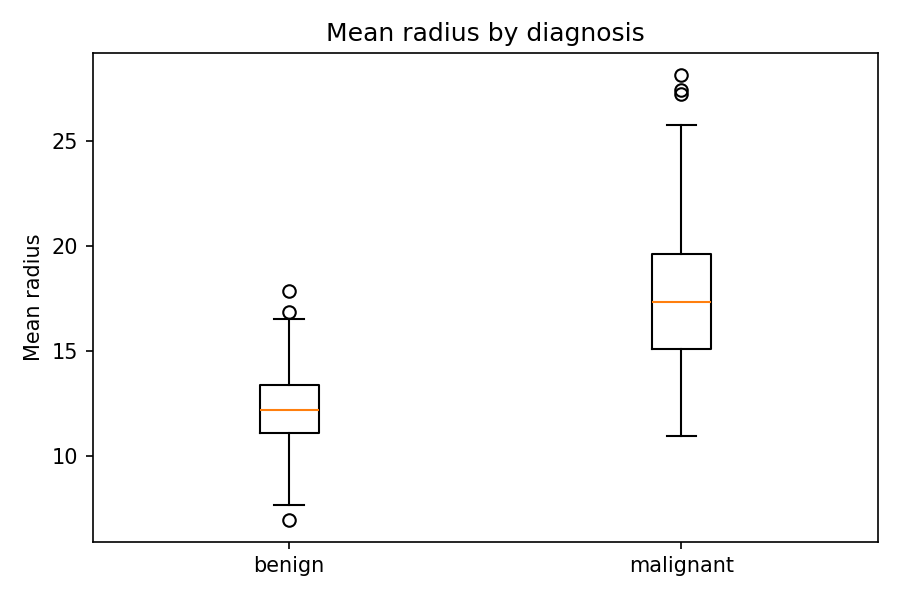
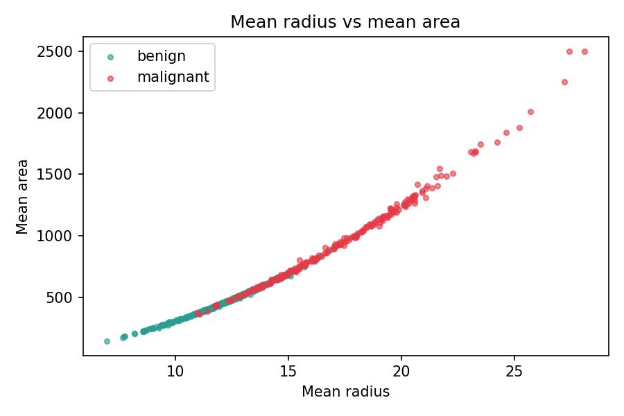

# Breast Cancer Data Analysis

Exploratory analysis of the Breast Cancer Wisconsin (Diagnostic) dataset
(569 tumours, 30 measurements each, loaded from scikit-learn).

Tools: Python (Pandas, Matplotlib), SQL (SQLite)

## What the scripts do

- `get_data.py` - exports the dataset to `breast_cancer.csv`
- `analysis.py` - checks for missing values and duplicates, cleans column names, compares tumours by diagnosis
- `sql_queries.py` - loads the data into SQLite and runs 6 SQL queries
- `charts.py` - makes 3 charts

## Findings

1. The dataset has 569 tumours: 357 benign and 212 malignant (37.3% malignant).
2. Malignant tumours have a larger average radius (17.46 vs 12.15).
3. Their average area is about twice as large (978.38 vs 462.79).
4. All 92 tumours with an area above 1000 are malignant.
5. Malignant tumours have a higher average concave points value (0.088 vs 0.026).

These are patterns in this dataset, not medical conclusions.

## How to run

    pip install pandas scikit-learn matplotlib
    python3 get_data.py
    python3 analysis.py
    python3 sql_queries.py
    python3 charts.py

## What I learned

(Write 2-3 lines in your own words.)
